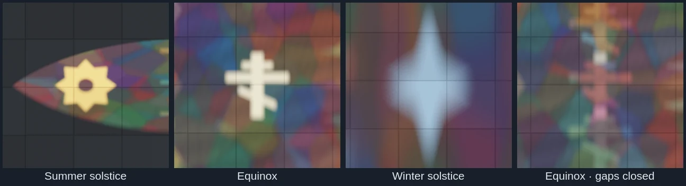

# Stained Glass Geometry

Three fixed panes cast a changing mosaic on the floor. As the sun moves, a ray crosses different pieces of glass. Those pieces filter the light together, so the colours and shapes on the floor change.

Leave a gap between the panes and an angled ray drops before it reaches the next one. In this model, the pale pieces step down 31 cm per pane so they line up into a three-bar cross at equinox noon. Close the gaps and the cross breaks up.



[Watch the 36-second film](https://github.com/parker-brown-family/stained-glass-geometry/releases/latest/download/stained-glass-geometry.mp4). Each seasonal day plays in 12 seconds.

## Run It

Use a C++20 compiler, Make, pkg-config, Cairo and Pango. Rendering the film also uses Python 3 and an FFmpeg build with libx264 and FFprobe.

```sh
make proof
make film
```

`make proof` renders the three panes, the three noon projections and the equinox with the gaps closed into `build/`. `make film` writes `build/stained-glass-geometry.mp4`.

The [geometry code](src/painted_glass.hpp) traces a ray from each floor point back through the panes. The model uses a south-facing window at 49° N, 2.8 m panes and 36 cm air gaps. The colours are approximate. [Solar position equations](https://gml.noaa.gov/grad/solcalc/solareqns.PDF) · [Layered colour filters](https://graphics.stanford.edu/courses/cs178-12/lectures/color1-15may12.pdf).
